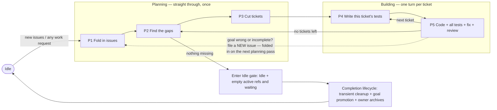

# Index

All agent routing and documentation must use these paths.

| Path                       | Role                                                                                                      |
| :------------------------- | :-------------------------------------------------------------------------------------------------------- |
| `.arca/goal/index.md`      | Goal front door: short summary plus links across the bundle.                                              |
| `.arca/goal/ubi-lang.md`   | Words the goal uses, defined once.                                                                        |
| `.arca/goal/spec.md`       | What the product must do — the deciding document for behavior.                                            |
| `.arca/goal/design.md`     | How it is built, technically; must follow `spec.md`.                                                      |
| `.arca/goal/test-list.md`  | The checks that prove the behavior: required checks, contract cases, state traces.                        |
| `.arca/tpl/`               | Blank forms only. A form filled in at its proper path is the real thing; the blank never is.              |
| `.arca/issue/<issue-id>/`  | One incoming issue: exactly five files (see The issue folder). Folder name = issue-id = `i-<nnn>-<slug>`. |
| `.arca/issue/archive/` | Reserved terminal issue history; never a live issue folder.                                                  |
| `.arca/current/current.md` | Where the work stands right now (from `.arca/tpl/current.md`).                                            |
| `.arca/current/log.md`     | Running history; new lines only, never edited (from `.arca/tpl/log.md`).                                  |
| `.arca/residual/`          | Gap records: one per requirement — is it proven yet? (from `.arca/tpl/residual.md`).                      |
| `.arca/residual/archive/` | Reserved terminal residual history; never part of the live gap scan.                                     |
| `.arca/ticket/`            | Small, self-contained pieces of work (from `.arca/tpl/ticket.md`).                                        |
| `.arca/ticket/archive/` | Reserved terminal ticket history; never part of the live ticket-work scan.                                |
| `.arca/io/`                | Input/output artifacts tracked by `input_revision`/`output_revision` in `current.md`.                     |
| `test/`                    | The test suite you can run (vitest).                                                                      |

# Two rule sets — read this first

There are two sets of rules. **They never limit each other.**

1. **Product rules** — `.arca/goal/` (order of authority: `spec.md` > `design.md` > `test-list.md`). They say
   what uni-spec-the-product does — the spec-standard it defines for an issue (a fork of OpenSpec,
   nucleus-only). They bind the product's behavior and what its tests expect — nothing else.
2. **Working rules** — this file. It says what a contributor (person or agent) does while building the
   product: gap records, tickets, tests, code.

If a goal sentence seems to forbid a working file (e.g. "no working files", "creates no code/tickets/tests"),
it is talking about the product, never about your workspace (`.arca/current/`, `.arca/residual/`,
`.arca/ticket/`, `test/`, source code). When two rules seem to clash: decide by which set each belongs to,
add one log line (`conflict-resolved: <refs> — <one-line reason>`), and keep going. **A rule clash is never a
reason to stop work.**

# Entry — no magic words

Any user request that touches this work — an issue, a gap, a ticket, tests, code, a fix, a test run — **is**
an entry. Start at the nearest step and catch up the earlier ones yourself: check each earlier step's finish
line; if it is unmet, produce the missing piece yourself, minimally. Never ask the user to run a step.

| User intent (examples)                                   | Enter at |
| :------------------------------------------------------- | :------- |
| "new issue", "integrate the issues"                      | P1       |
| "what's missing", "where are the gaps"                   | P2       |
| "plan the work", "cut tickets"                           | P3       |
| "write/implement the tests", "implement the vitest tests" | P4       |
| "implement", "fix", "run QA"                             | P5       |

`start issue loop` still works (enters P1). Once entered, run on your own all the way through the build loop
without prompting. Return to Idle when no gap record says `missing` or `partial`, or when the user says stop.

# Never get stuck — the answer ladder

There is no `blocked` status. When something you need is missing, in this order:

1. **Work it out** from the defaults table or from how the repo already does things.
2. **Pick the safest reasonable value**; log `assumed: <what> — <why>`; keep going. A guess can be undone:
   if the user corrects it, redo the affected pieces — don't start over.
3. **Ask** — put every open question into one message, and meanwhile keep doing all work that does not
   depend on the answers. Note `waiting_on` in `current.md` for the waiting piece only.

An unanswered question pauses only the piece that needs it, never the whole.

## Defaults

| Input                        | Default                                                                                        |
| :--------------------------- | :--------------------------------------------------------------------------------------------- |
| Goal freeze                  | Note the current git HEAD of `.arca/goal/` as the frozen version. Writing that note IS the freeze. |
| Ticket approval              | Approved the moment it is created. The user may say `hold t-<id>` to pause that one ticket.    |
| `test_root`                  | `test/` (vitest suite; config in `vitest.config.ts`).                                          |
| `discovery_command` / `run_command` | By language — TypeScript: `pnpm test` (vitest); otherwise look at the repo and pick.    |
| `fixture_setup`              | Copies of test data in a temp folder, kept separate per test; none when not needed.            |

# The work — one straight pass, then a loop

The work has two parts with different shapes:

- **Planning (P1 → P2 → P3)** runs **straight through, once**, each time new issues come in. It never loops.
  Many issues become one frozen goal, the goal is compared against reality, and each gap becomes one ticket.
- **Building (P4 → P5)** is **a loop: one full turn per ticket**. This is where nearly all the time goes.
  For each ticket: write its tests, try to poke holes in them, write the code, run everything, fix until
  green, review, take the next ticket.

The two parts meet at the gap check (P2). When the last ticket is done, do the gap check again. If something
is still missing, cut more tickets and keep building. If nothing is missing, enter the Idle gate, invoke the
end-of-loop completion lifecycle to clean transient products, promote evidence, and owner-archive eligible
records, then remain Idle and rest. Completion—not the green check by itself—is how the loop finishes.

**The only road back:** if, while building, you find the goal itself is wrong or incomplete — do **not**
touch the goal. Write a **new issue** into `.arca/issue/`. It gets folded in on the next planning pass. From
the moment the goal is frozen until the last ticket is done, the goal does not move.

## The issue folder

- Each direct child of `.arca/issue/` other than the reserved `archive/` directory is a live issue folder holding exactly five files created from `.arca/tpl/issue/`:
  `index.md` (front door: identity, where it came from, status, links), `ubi-lang.md` (issue-specific words,
  or `No issue-specific terms.`), `spec.md` (what is asked for, plus what was decided about each ask),
  `design.md` (suggested how — carries no weight until folded into the goal), `test-plan.md` (how to prove it
  works, plus traces).
- Naming: folder name = `issue-id` = `i-<nnn>-<condensed-name>` — zero-padded number plus a short dashed name
  taken from the title (2–4 words, e.g. `i-007-continuous-qa`). `<nnn>` alone guarantees uniqueness and
  order; the name part is set at creation and does not change if the title changes later.
- `index.md` front matter: `issue-id` equal to the folder name, non-empty origin, status
  `pending|integrated|rejected`; relative links to the other four files; no unfilled template blanks.
- Shape check (read-only, done by the agent, no extra tooling): when an issue changes and when P1 finishes,
  confirm the folder shape, files, fields, links, and that no blanks remain. A failed check is a **fix you do
  right away**, not a stop; log the check and the fix.
- Creating an issue is a direct act: write the five files from the blanks, run the shape check, done. It
  enters no loop step and touches nothing in `.arca/current/`; the next planning pass folds it in.

## End-of-loop cleanup and owner archives

- Only the direct `.arca/issue/archive/`, `.arca/residual/archive/`, and `.arca/ticket/archive/` directories are reserved owner archives. Each archive and every descendant recursively is excluded from live issue shape checks, gap scans, and ticket-work scans. Identifier allocation is a separate recursive scan across both live records and archived descendants: every archived issue, residual, and ticket ID remains reserved and must never be reused.
- Archive eligibility is terminal and type-specific: issue status `integrated|rejected`, residual status `satisfied`, and ticket status `done`. Close every selected record to its terminal status before relocation. An active or nonterminal record must never be archived, and a record named by `active_refs` must not be archived.
- The final green gap recheck and Idle gate precede one atomic, idempotent completion lifecycle. Completion is gated on the recheck finding no `missing|partial` residual and on `.arca/current/current.md` already entering `phase: Idle` with `status: idle`, empty `active_refs`, and empty `waiting_on`. Only then sweep the eligible records beneath their owning archives: **selection is by terminal status alone** — every `integrated|rejected` issue, every `satisfied` residual, and every `done` ticket, regardless of which loop created it, including records left live by earlier loops. Validate the complete source/destination set and all repaired links first, then apply every move or none. A repeat against an unchanged completed tree performs zero moves, changes no current fields, and appends no duplicate completion line; a mixed or conflicting partial state is an error to repair, never permission for another partial move.
- After a sweep, each live collection directly holds only nonterminal records and its reserved `archive/`: `.arca/issue/`, `.arca/residual/`, and `.arca/ticket/` list what is still unfinished, and finished work is read from the archives. Every retention, preservation, or census check resolves a record at its live or archived location and counts live and archived records together, so relocation is never observable as loss. Markdown links are repaired on relocation; frozen evidence written in `.arca/io/`, in record bodies, and in `.arca/current/log.md` keeps its original wording and is resolved live-or-archived instead of being rewritten.
- Cleanup removes only transient, reproducible working products such as generated output, installed dependencies, caches, temporary fixtures, and equivalent task temporaries. It permanently preserves `.arca/goal/`, product source, executable tests, `.arca/io/` evidence, standards, permanent verification evidence, archived records, and append-only `.arca/current/log.md` history.
- `.arca/goal/` remains physically in place as the cumulative current authority and stable front door. Goal promotion records in `.arca/current/current.md` the completed loop's exact P2 frozen Git HEAD and ordered filename-NUL-content goal-bundle SHA-256. Link normalization required after archival may change the current goal files' bytes and may be recorded separately as an output revision or digest, but it changes no frozen requirement wording, decision, ID, or semantics and does not replace the recorded P2 frozen revision.

## The steps (P1–P5)

**Planning — straight through, once per batch of issues:**

| Step                  | Does                                                                                                             | Finish line                                                                          |
| :-------------------- | :--------------------------------------------------------------------------------------------------------------- | :----------------------------------------------------------------------------------- |
| **P1** Fold in issues | Work every `pending` issue into the goal: give each ask a stable requirement ID and a decision `accepted|rejected|duplicate|deferred`, link everything both ways; shape check | Every issue ends `integrated|rejected`; all links resolve (fix them yourself, don't set them aside) |
| **P2** Find the gaps  | Freeze the goal (note git HEAD), then compare each requirement against what actually exists; write one record in `.arca/residual/` per requirement: `missing|partial|satisfied`, with pointers to the proof and a short why | Every requirement has exactly one record; no proof ⇒ never `satisfied`               |
| **P3** Cut tickets    | Turn each `missing|partial` record into one small, self-contained, provable piece of work in `.arca/ticket/` (from `.arca/tpl/ticket.md`); order them so a ticket that needs another comes after it; **approved on creation** | Each such record ↔ exactly one ticket; all links resolve                             |

**Building — one full turn per ticket, in order:**

| Step                            | Does                                                                                                             | Finish line                                                                          |
| :------------------------------ | :--------------------------------------------------------------------------------------------------------------- | :----------------------------------------------------------------------------------- |
| **P4** Write this ticket's tests | Turn the ticket's planned checks (planned-test-ID → test function, recorded in the ticket) into runnable tests; then re-read them trying to poke holes: would they catch a wrong answer, do they cover the edges, does each stand alone; run them — they should fail, since the code is not written yet | Every planned check for this ticket runs as a real test; hole-poking notes logged    |
| **P5** Write the code           | Implement; run **every test so far** (all earlier tickets' plus this one's); fix and re-run until all green; short review; take the next ticket | All tests green. No tickets left → redo P2's gap check → enter the Idle gate when nothing is `missing|partial` → invoke the completion lifecycle → remain Idle and rest |

# State

- `.arca/current/current.md`: `phase`, `status: running|waiting|idle`, versions in play,
  `waiting_on` (the open question plus the one piece waiting on it — nothing else).
- `.arca/current/log.md`: new lines only, never edited; one line per step change, guess, rule-clash
  decision, or fix.

# Rule

Do:

- Enter on any work-shaped request; catch up missing earlier steps yourself.
- Prefer work-it-out > safe guess > ask; log every guess; put all questions in one message.
- Write each ticket's tests in P4, before its code.
- Fill in real files from the blanks in `.arca/tpl/`; keep `.arca/current/log.md` new-lines-only.
- Found a goal problem mid-build? File a new issue in `.arca/issue/` — that is the only road back.

Don't:

- Don't apply `.arca/goal/` product rules to working files — decide by rule set and keep going.
- Don't use a `blocked` status; `waiting` pauses only the piece that is waiting.
- Don't mark a gap record `satisfied` without proof.
- Don't edit the frozen goal while tickets are open.
- Don't stop on failed checks or rule clashes — fix, log, keep going.

# Worked example

User: "I want to implement the tests" →

1. Route: **P4**. Catch up: P1 (fold in any `pending` issues, else log the skip) → P2 (freeze = note git
   HEAD; write one gap record per requirement) → P3 (one approved ticket per `missing|partial` record).
2. Loop, one ticket at a time: **P4** — write one vitest test under `test/` per planned check recorded in
   the ticket; poke holes in your own tests; `pnpm test` (failing is expected). **P5** — write the code;
   `pnpm test` full suite; fix; review; next ticket.
3. No tickets left → redo the gap recheck → when green, enter the Idle gate → invoke the completion lifecycle for transient cleanup, goal promotion, and eligible owner archives → remain Idle and rest.

Zero questions unless something truly cannot be worked out — then one batched message while every independent
piece keeps moving.
